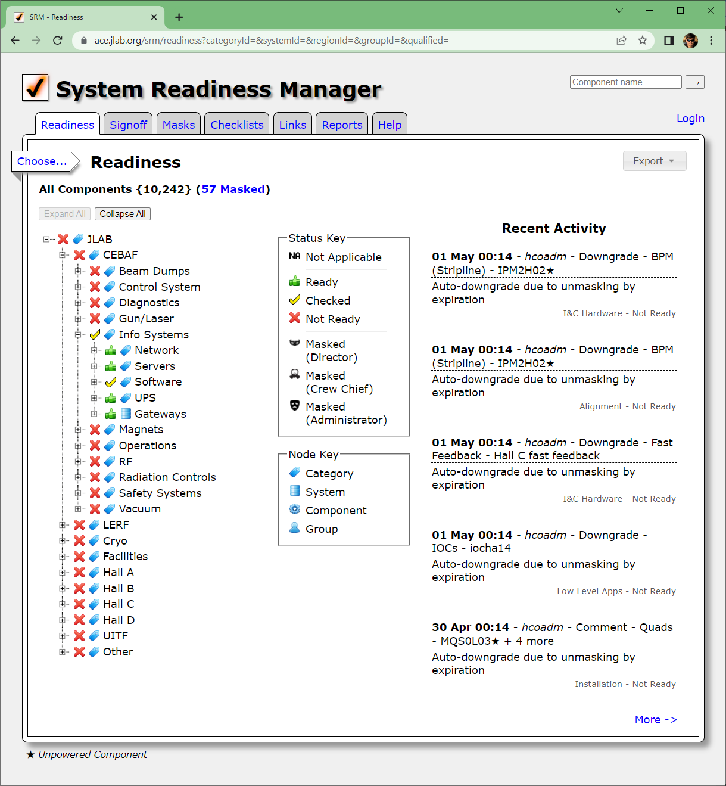

# Readiness

[User Guide](README.md) › Readiness

The **Readiness** tab is the front page of SRM: the whole machine as a tree, each node colored
by its [status](concepts.md#statuses). Operations uses it to see whether beam can be sent to a
destination and, if not, which components and groups are holding it back. Anyone can view it
without logging in.

## The tree

The tree follows the [inventory](concepts.md#categories-systems-and-components): categories
contain categories or systems, systems contain components, and each component lists its
[responsible groups](concepts.md#responsible-groups) in signoff order.

| Node | Its status |
|---|---|
| **Group** (under a component) | That group's signoff for the component. A group that hasn't signed off yet is Not Ready. |
| **Component** | The worst of its groups' signoffs, or its mask if it is [masked](masks.md). |
| **System** | The worst of its components that match the filter, leaving out masked components. |
| **Category** | The worst of the systems below it. |

A system or category with nothing to check (no components match, or all of them are masked) shows
Ready. The **Status Key** and **Node Key** beside the tree explain the icons: a green thumbs-up
is Ready, a yellow check mark is Checked, and a red cross is Not Ready. A ★ after a component's
name marks it as [unpowered](concepts.md#unpowered-components).

Open a node to see what is below it. **Expand All** opens every category and system at once, and
is only available when the filter leaves 100 components or fewer; with that few, the tree opens
by itself. **Collapse All** closes everything. The tree remembers which nodes you had open.

Select a component to open its **Component Information** dialog, the same page as the
[component detail report](reports.md#component-detail).

## Filtering

**Choose...** opens the filter. The line under the page title says what is selected and, in
braces, how many components match; **Clear** removes the filter.

| Filter | Keeps components |
|---|---|
| **Beam Destination** (Include) | that take part in any of the chosen [beam destinations](concepts.md#beam-destinations). The **Current Run** link chooses the destinations of the current run. |
| **Category**, **System** | in that part of the inventory. Choosing a category narrows the System list. |
| **Region** | in that [region](concepts.md#regions) of the machine. |
| **Group** | that the group is responsible for. |
| **Status** | whose status is one of the chosen ones. |
| **Beam Destination** (Exclude) | that take part in none of the chosen destinations. |

The statuses of systems and categories follow the filter. For example, with Beam Destination set
to one hall, a category is Ready when every component needed for that hall is Ready, whatever
the state of the rest of the machine.

When masked components match the filter, the selection line ends with a link such as
**(3 Masked)**, which opens the [current masks](masks.md#current-masks) with the same filter.

## Recent Activity

The **Recent Activity** panel lists the five latest signoff changes that match the filter: when,
who, the kind of change, the system and component (and how many more components were signed off
with it), the comment, and the group and its new status. Components signed off together are one
entry. **Show more** adds the next ten entries, and **Signoff Activity** opens the
[Signoff Activity report](reports.md#signoff-activity) with the same filter, which has a row for
each component.

## Signing off from the tree

Select a group under a component to change that one signoff; SRM asks you to log in first. The
**Edit Group Signoff** dialog has the same **Status**, **Comment** and **Needs Attention** fields
as the Signoff tab, and the same [rules](signoff.md#signoff-rules) apply, with one difference: a
downgrade made here doesn't [cascade](signoff.md#downgrades-and-cascades) to the groups after
yours. To sign off several components at once, or to downgrade with a cascade, use the
[Signoff tab](signoff.md).

## Export

**Export › System Excel** downloads a spreadsheet of the whole inventory outline: every category
and system, indented as in the tree, with the number of components in each system. It ignores the
filter.
